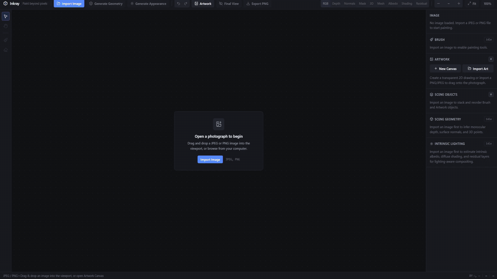
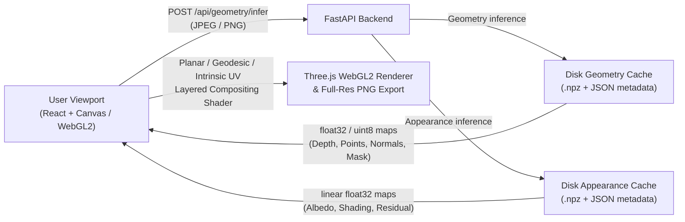

# Inkray

> **Paint beyond pixels.**

Inkray is an open-source, geometry- and lighting-aware photo editor inspired by Adobe's Project Deep Brush. Instead of editing photographs solely in flat screen coordinates, Inkray reconstructs monocular 3D geometry and intrinsic lighting layers once per photograph, then runs real-time perspective painting, curved-surface artwork wrapping, layered object compositing, foreground occlusion, and illumination-aware shading directly on the GPU.



---

## Contents

- [Capabilities](#capabilities)
- [Architecture](#architecture)
- [Quick Start](#quick-start)
- [Backend Configuration](#backend-configuration)
- [Inference Models](#inference-models)
- [Workflow & Shortcuts](#workflow--shortcuts)
  - [Quick UI Tutorial](#quick-ui-tutorial)
  - [Keyboard Shortcuts](#keyboard-shortcuts)
- [API Endpoints](#api-endpoints)
- [Development & Verification](#development--verification)
- [Project Structure](#project-structure)
- [Contributing](#contributing)
- [License & Model Attribution](#license--model-attribution)

---

## Capabilities

- **Automatic 3D Surface-Aware Painting:** Pick **Brush** (`B`) or **Eraser** (`E`) and paint directly on any photograph without manual plane selection. Inkray inspects the inferred geometry beneath each stroke and automatically chooses:
  - *Planar projection* with deterministic local PCA plane fitting and coplanar bridging behind foreground occluders.
  - *Curved / irregular surface projection* using intrinsic first-fundamental-form metrics and bounded shortest-path geodesic distances across the continuous 2.5D mesh without crossing depth jumps or holes.
  - *Clean 2D fallback* when geometry has not been inferred yet or when painting over unmapped regions.
- **Brush Objects, Artwork Objects & Drag-and-Drop Priority Stack:** Group freehand strokes into named **Brush Objects**, create additional separate Brush Objects whenever needed (**New Brush** / **New Brush Object**), place 2D drawn or imported artworks onto surfaces, toggle per-object visibility, and drag rows in the **Scene Objects** panel to control exact front-to-back display order (for example painting strokes cleanly in front of or behind placed artwork).
- **2D Artwork Canvas & Curved Surface Wrapping:** Create multi-stroke transparent graphics in a dedicated 2D artwork workspace or import PNG/JPEG images preserving alpha, then place them onto photographs:
  - Automatically selects **planar projection** on flat walls/floors/surfaces, **bounded intrinsic surface wrapping** (parallel-transported tangent parameterizations with local relaxation) on cylindrical, spherical, and smoothly curved objects, or **2D overlay fallback** on invalid/degenerate regions.
  - Supports interactive translation (including seamless transitions across connected walls, floors, and objects), aspect-preserving scaling, rotation, opacity control, explicit re-anchoring, and live non-destructive edits to shared source artwork assets.
- **Foreground Occlusion:** Strokes and placed artwork depth-test against reconstructed surfaces and occluders so edits naturally sit behind closer foreground elements.
- **Lighting-Aware Compositing:** Use `Albedo`, `Shading`, and `Residual` layers in the GPU-accelerated **Flat**, **Shading**, and **Texture** paint modes. For models that predict only albedo, Inkray derives shading and residual from the photo. **Texture Detail** controls how much fine surface variation shows through.
- **Inspection, History & Full-Resolution Export:** Inspect RGB, depth, normals, masks, 3D point clouds, meshes, and appearance layers. Compare depth estimates in **Diff**, hide editing guides with **Final View** (`P`), undo edits, and export PNGs at the original photo resolution.

---

## Architecture

Inkray splits heavy monocular ML inference from interactive editing so all painting, surface unwrapping, transforms, and compositing happen locally without per-frame server calls:



- **Backend (`backend/`):** FastAPI inference service with content-addressed disk caches for geometry and appearance and optional CUDA offloading.
- **Frontend (`frontend/`):** React 19 + strict TypeScript + Vite + Three.js application. Geometry classification, geodesic solvers, and local tangent parameterizations stay decoupled from React UI components inside `src/geometry/` and `src/painting/`.

---

## Quick Start

### Prerequisites

- Linux, Windows or macOS on Apple Silicon (arm64 Python).
- Python 3.10+ and Node.js 20+ (CI uses Node 22).
- A WebGL2-capable browser. An NVIDIA GPU speeds up inference on Linux and Windows.

### 1. Set Up & Start the Backend

From the repository root, create an environment and install the backend.

```bash
cd backend
python3 -m venv .venv
source .venv/bin/activate
python -m pip install -e ".[dev]"
python -m uvicorn app.main:app --host 127.0.0.1 --port 8000
```

On Windows use `py -m venv .venv` and activate with `.venv\Scripts\Activate.ps1`. For CUDA, install the matching `torch` and `torchvision` builds using the [PyTorch installer](https://pytorch.org/get-started/locally/) before installing the backend.

The base installation includes **Depth Pro**, **Marigold Normals v1.1**, and **Marigold IID Lighting**. On macOS they run on CPU by default. Public Hugging Face weights download on first use.

#### Optional MoGe-3 installation

On Linux or Windows with CUDA, install the extra in the same backend environment. The extra keeps FlexGEMM and Triton out of the portable installation used on macOS.

```bash
python -m pip install -e ".[moge]"
```

On Windows install the [Triton build for your PyTorch version](https://github.com/triton-lang/triton-windows#3-pytorch) in the same environment. The backend uses MoGe-3 by default when its runtime is available and Depth Pro otherwise.

### 2. Install & Start the Frontend

In a second terminal:

```bash
cd frontend
npm install
npm run dev
```

Vite serves the editor (typically at `http://localhost:5173`) and proxies `/api/*` requests to `http://127.0.0.1:8000`.

---

## Backend Configuration

Optional environment variables supported by `backend/app/config.py`:

| Variable | Default | Description |
| --- | --- | --- |
| `INKRAY_MOGE_MODEL_ID` | `Ruicheng/moge-3-vitl` | Hugging Face MoGe-3 checkpoint ID |
| `INKRAY_APPEARANCE_MODEL_ID` | `prs-eth/marigold-iid-lighting-v1-1` | Hugging Face Marigold IID Lighting checkpoint ID |
| `INKRAY_NORMALS_MODEL_ID` | `prs-eth/marigold-normals-v1-1` | Hugging Face Marigold Normals checkpoint ID |
| `INKRAY_DEVICE` | `auto` | `auto`, `cuda`, or `cpu` |
| `INKRAY_MAX_UPLOAD_BYTES` | `33554432` | Maximum uploaded file size in bytes (32 MiB) |
| `INKRAY_MAX_IMAGE_PIXELS` | `64000000` | Maximum source image pixel count before decoding |
| `INKRAY_MAX_IMAGE_SIZE` | `1024` | Maximum image edge sent to the geometry model |
| `INKRAY_APPEARANCE_MAX_IMAGE_SIZE` | `1024` | Maximum image edge sent to the appearance model |
| `INKRAY_MOGE_RESOLUTION_LEVEL` | `9` | MoGe-3 inference resolution level |
| `INKRAY_MOGE_REFINE_STEPS` | `3` | MoGe-3 iterative refinement steps |
| `INKRAY_MOGE_FP16` | `true` | Run MoGe-3 refinement in half precision on CUDA |
| `INKRAY_APPEARANCE_FP16` | `true` | Load fp16 Marigold IID variant on CUDA |
| `INKRAY_APPEARANCE_STEPS` | `4` | Marigold IID LCM denoising steps |
| `INKRAY_APPEARANCE_RES` | `768` | Marigold IID internal processing resolution |
| `INKRAY_APPEARANCE_ENSEMBLE` | `1` | Marigold IID prediction ensemble size |
| `INKRAY_APPEARANCE_SEED` | `42` | Deterministic Marigold IID diffusion seed |
| `INKRAY_NORMALS_FP16` | `true` | Load fp16 Marigold Normals variant on CUDA |
| `INKRAY_NORMALS_STEPS` | `4` | Marigold Normals LCM denoising steps |
| `INKRAY_NORMALS_RES` | `768` | Marigold Normals internal processing resolution |
| `INKRAY_NORMALS_ENSEMBLE` | `1` | Marigold Normals prediction ensemble size |
| `INKRAY_NORMALS_SEED` | `42` | Deterministic Marigold Normals diffusion seed |
| `INKRAY_OFFLOAD_INACTIVE_MODELS` | `true` | Move inactive model weights to CPU before switching on CUDA |
| `INKRAY_IID_IN_THE_WILD_WEIGHTS` | `v2` | IID-in-the-Wild release tag (`v2` or `v2.1`) |
| `INKRAY_IID_IN_THE_WILD_BASE_SIZE` | `384` | IID-in-the-Wild base ordinal resolution |
| `INKRAY_CACHE_DIR` | `backend/.cache/geometry` | Disk cache directory for inferred geometry |
| `INKRAY_APPEARANCE_CACHE_DIR` | `backend/.cache/appearance` | Disk cache directory for inferred appearance layers |

## Inference Models

| Model | Output in Inkray | Linux | Windows | macOS (Apple Silicon) | Setup |
| --- | --- | --- | --- | --- | --- |
| MoGe-3 | Depth, points, normals, camera intrinsics | CUDA | CUDA with Triton for Windows | Unsupported | `.[moge]` extra |
| Apple Depth Pro | Depth and camera FOV. Inkray derives points and normals | CPU / CUDA | CPU / CUDA | CPU | Base install |
| Marigold Normals v1.1 | Independent normals for lightweight default depth refinement | CPU / CUDA | CPU / CUDA | CPU | Base install |
| Marigold IID Lighting v1.1 | Albedo, diffuse shading, residual | CPU / CUDA | CPU / CUDA | CPU | Base install |
| Marigold V2 Albedo | Albedo | CUDA | Unsupported | Unsupported | Marigold V2 setup |
| Marigold V2 Normals | Independent normals for optional depth refinement | CUDA | Unsupported | Unsupported | Marigold V2 setup |
| Latent Intrinsics | Albedo | CPU / CUDA | CPU / CUDA | CPU | Latent Intrinsics setup |
| IID-in-the-Wild | Linear albedo, colorful diffuse shading, residual (non-commercial) | CPU / CUDA | CPU / CUDA | CPU | `.[iid-in-the-wild]` extra |

After importing a photo, use **Geometry Model** under **Scene Geometry** or **Appearance Model** under **Intrinsic Lighting**. The editor shows availability for the connected backend.
The selectors show whether the chosen model allows commercial use and flag non-commercial options (`Latent Intrinsics` and `IID-in-the-Wild`). The [model attribution section](#license--model-attribution) links to the upstream terms.

### Marigold V2

On Linux with CUDA, install the extra from `backend/` in the existing Inkray environment. Install CUDA builds of PyTorch and torchvision first. Marigold IID and V2 share Diffusers 0.38.0.

```bash
python -m pip install -e ".[marigold-v2]"
```

Use `python -m pip install -e ".[moge,marigold-v2]"` to install both extras. Restart the backend after installation.

Your first run from the editor prepares the pinned inference scripts and downloads about 43 GB into `backend/.cache/models/marigold-v2/assets`. This includes the Qwen transformer and VAE (about 41 GB) and the selected Marigold V2 adapter (about 1.85 GB). Albedo and Normals share Qwen. Running the other option adds only its adapter and prompt embeddings. A storage check runs before the download, and retries reuse downloaded files. **Stop Waiting** leaves the backend download or inference running.

The [upstream project](https://github.com/huawei-bayerlab/marigold-v2) reports about 17 GB of VRAM at 1024x1024. Quantization reduces GPU memory use during loading.

For depth refinement, check **Refine depth with normals** before running either geometry model. Inkray defaults to **Marigold Normals v1.1** (lightweight, runs on CPU or CUDA across platforms) and also supports **Marigold V2 Normals** on Linux CUDA. It uses the predicted normals to adjust local depth gradients while anchoring to the original depth and protecting depth jumps. Check **Smooth depth & normals** to apply uniform continuity-aware smoothing passes across valid depth and surface normals.

### Latent Intrinsics (Non-commercial)

Unlike the models installed via `pip`, [xiao7199/Latent_Intrinsics](https://github.com/xiao7199/Latent_Intrinsics) does not ship a `setup.py` or `pyproject.toml` package definition, and its `unets.py` carries a **CC BY-NC-SA 4.0** (non-commercial, share-alike) notice that cannot be bundled inside Inkray's MIT source tree. Because of that, it lives outside the package in `backend/.cache/models/latent-intrinsics`.

From `backend/`, clone the authors' repository and check out the pinned commit:

Linux / macOS (`bash` / `zsh`):

```bash
mkdir -p .cache/models
git clone https://github.com/xiao7199/Latent_Intrinsics.git .cache/models/latent-intrinsics
git -C .cache/models/latent-intrinsics checkout --detach dcc4385e20f536a03d6a5520c3652b35fc438cc2
```

Windows (PowerShell):

```powershell
New-Item -ItemType Directory -Force .cache\models | Out-Null
git clone https://github.com/xiao7199/Latent_Intrinsics.git .cache/models/latent-intrinsics
git -C .cache/models/latent-intrinsics checkout --detach dcc4385e20f536a03d6a5520c3652b35fc438cc2
```

Restart the backend normally. The base backend environment runs the model on CPU or CUDA across Linux, Windows, and macOS, and the first inference downloads the pinned EMA checkpoint (1.56 GB) into the standard Hugging Face cache.

Deployments with existing installations can override the default paths with `INKRAY_LATENT_INTRINSICS_REPO`, `INKRAY_LATENT_INTRINSICS_CHECKPOINT`, `INKRAY_MARIGOLD_V2_REPO`, or `INKRAY_MARIGOLD_V2_PYTHON`.

### IID-in-the-Wild (Non-commercial)

Install the academic-only `compphoto/Intrinsic` extra from `backend/` in your Inkray environment and restart the backend:

```bash
python -m pip install -e ".[iid-in-the-wild]"
```

The first run downloads the pretrained PyTorch checkpoints via `torch.hub` and produces linear albedo, colorful diffuse shading, and residual maps.

### Lighting from albedo

For albedo-only results, the editor estimates diffuse shading from the linear photo and albedo. It uses nearby pixels with similar albedo to handle isolated highlights and weak observations, and keeps the difference from the original photo as a residual. **Texture** also retains fine variations from the albedo under the new paint. This is Inkray's own image-space approximation of the diffuse and residual image model described by [Careaga and Aksoy](https://arxiv.org/html/2409.13690#S3.SS3).

---

## Workflow & Shortcuts

### Quick UI Tutorial

The top toolbar handles import, reconstruction, views, and export. Tools are on the left; brush settings, artwork, and scene objects are in the right sidebar.

1. **Load a Photograph:** Click **Import Image** (`O`) or drop a JPEG/PNG into the viewport. Click **Generate Geometry** before painting to make new strokes follow scene surfaces; without geometry, painting works in 2D. Use the top view buttons to inspect depth, normals, or the 3D **Points** / **2.5D Mesh** viewport (double-click any surface point to set the orbit origin). Return to **RGB** to edit.
2. **Paint on the Photo:** Select **Brush** (`B`), choose **Color**, **Size**, **Opacity**, and **Hardness** in the sidebar, then drag to paint. **Eraser** (`E`) removes paint from the active Brush Object. Click **New Brush** to keep another set of strokes separate. Scroll to zoom, hold `Space` and drag to pan, and press `F` to fit the photo.
3. **Match the Lighting:** Click **Generate Appearance**, then choose a mode under **Intrinsic Lighting**: **Flat** for plain color, **Shading** to preserve scene shadows, or **Texture** to retain surface detail. In **Texture** mode, adjust **Texture Detail** to control how much detail shows through.
4. **Add Artwork:** In the sidebar, use **New Canvas** to draw on a transparent canvas or **Import Art** to load a PNG/JPEG. Click **Photo View** to return from the artwork workspace, then drag an artwork from the sidebar onto the photo. Its `+` button places a copy at the photo center.
5. **Arrange the Scene:** Select **Pointer** (`V`) to move placed artwork, drag its corners to scale, or use the top handle to rotate. Adjust **Opacity** or use **Edit Art** in the inspector. In **Scene Objects**, select a Brush Object to paint into it, drag rows to reorder them (`#1` is in front), and use the eye buttons to toggle visibility.
6. **Review & Export:** Use `Ctrl/Cmd + Z` to undo and `Ctrl/Cmd + Shift + Z` to redo. Click **Final View** (`P`) to hide guides and handles, then **Export PNG** to save the composite at the original photo resolution.

The first geometry result becomes active. Run another geometry model or enable normal refinement to add a result for the same photo. Select it under **Compare against active**, then click **View Depth Difference**. The editor aligns camera-axis depths using a single scale fitted to the median log ratio of shared valid pixels. Blue means the compared result is nearer and orange means farther. **Gap > 25%** counts shared pixels where the larger aligned depth exceeds the smaller by more than 25%. The factor applies to the comparison only. **Use Compared Geometry** switches the active result before any geometry-dependent edits.

**Stop Waiting** stops waiting in the editor and preserves the last successful result. Inference already running in the backend continues and may populate the disk cache.

Brush strokes retain their gesture order when switching between 2D, planar, and curved painting. The eraser removes paint within the active Brush Object across those projections. Artwork deletion and canvas resizing support undo/redo, and PNG export remains available from the artwork workspace when a photograph is loaded.

### Keyboard Shortcuts

| Shortcut | Action |
| --- | --- |
| `O` or `Ctrl/Cmd + O` | Import or replace source photograph |
| `Space + Left-Drag` / `Middle-Drag` | Pan viewport |
| `Wheel` / `Trackpad Pinch` | Zoom anchored at cursor |
| `V` | Pointer tool (select and transform artwork placements) |
| `H` | Hand tool (pan viewport) |
| `B` | Brush tool |
| `E` | Eraser tool |
| `[` / `]` | Decrease / increase brush size |
| `P` | Toggle **Final View** (hide/show guides & handles) |
| `Delete` / `Backspace` | Remove selected artwork placement |
| `Ctrl/Cmd + Z` | Undo stroke, priority reorder, or placement action |
| `Ctrl/Cmd + Shift + Z` or `Ctrl/Cmd + Y` | Redo |
| `F`, `0`, or `Ctrl/Cmd + 0` | Fit image to viewport |
| `1` or `Ctrl/Cmd + 1` | Zoom to 100% (`1 source px = 1 CSS px`) |
| `+` / `-` | Zoom in / out |

---

## API Endpoints

The FastAPI backend exposes binary array and JSON metadata routes under `/api`:

- `GET /api/models` -- Report default geometry and normal models and unavailable model options.
- `POST /api/geometry/infer` -- Infer or load cached geometry. The optional `model` query parameter accepts `moge-3` or `depth-pro`. Set `refine_normals=true` (and optional `normal_model` = `marigold-normals` or `marigold-v2`) to apply normal refinement, and `smooth_iterations` (`0`..`10`) to apply uniform depth and normal smoothing as separate cached entries.
- `GET /api/geometry/{geometry_id}` -- Fetch cached geometry metadata.
- `GET /api/geometry/{geometry_id}/maps/{kind}` -- Stream `depth`, `points`, `normals`, or `mask` binary arrays.
- `POST /api/geometry/{geometry_id}/surface/select` -- Server-side surface selection endpoint.
- `POST /api/appearance/infer` -- Infer or load cached appearance. The optional `model` query parameter accepts `marigold-iid`, `marigold-v2`, `latent-intrinsics`, or `iid-in-the-wild`. The response's `arrays` field lists the maps available for the result.
- `GET /api/appearance/{appearance_id}` -- Fetch cached appearance metadata.
- `GET /api/appearance/{appearance_id}/maps/{kind}` -- Stream `albedo`, `shading`, or `residual` binary float32 arrays.

---

## Development & Verification

### Frontend Checks (`frontend/`)

```bash
cd frontend
npm run typecheck      # Strict TypeScript check (tsc -b --noEmit)
npm run lint           # ESLint check
npm run format:check   # Prettier style check
npm test               # Vitest unit & synthetic geometry suite
npm run build          # Production typecheck + Vite bundle
npx playwright install chromium
npm run test:e2e       # Inference controls and comparison in Chromium
```

### Backend Checks (`backend/`)

Run inside your activated Conda environment (`conda activate inkray`) or with `.venv/bin/...`:

```bash
cd backend
pytest -v                                     # API, geometry, appearance, & cache tests
python scripts/smoke_moge.py                  # Real MoGe-3 CUDA + disk cache smoke test
python scripts/smoke_marigold.py --with-moge  # Marigold CUDA + MoGe memory-swap check
python scripts/evaluate_appearance.py         # Synthetic shading calibration evaluation
```

---

## Project Structure

```text
inkray/
|-- frontend/
|   |-- src/
|   |   |-- api/            # Binary array HTTP clients for geometry & appearance endpoints
|   |   |-- components/     # Toolbars, artwork canvas view, inspector sidebar, status bar
|   |   |-- editor/         # Canvas renderer, 3D point/mesh viewer, viewport transforms
|   |   |-- geometry/       # OpenCV geometry math, plane fitting, continuity, geodesic & unwrap solvers
|   |   |-- hooks/          # Resize observer, DPR, image import, keyboard shortcuts
|   |   |-- painting/       # Brush engine, decal/artwork models, lighting calibration, WebGL2 renderer
|   |   |-- state/          # Immutable editor reducer, context provider, cursor store
|   |   |-- styles/         # Theme tokens, global CSS, and editor layout styles
|   |   |-- types/          # Shared TypeScript interfaces
|   |   \-- utils/          # File validation and display formatters
|   |-- eslint.config.js
|   |-- tsconfig.json
|   |-- vite.config.ts
|   \-- package.json
|-- backend/
|   |-- app/
|   |   |-- api/            # FastAPI routers (/api/geometry, /api/appearance)
|   |   |-- appearance/     # Albedo/shading/residual types, sRGB transforms, shading calibration
|   |   |-- cache/          # SHA-256 disk caches for inferred maps
|   |   |-- geometry/       # Depth/normals/points containers, RANSAC plane fitter, surface selector, refinement & smoothing
|   |   |-- inference/      # Depth, normal and appearance model adapters
|   |   |-- utils/          # Image decoding and EXIF orientation normalization
|   |   |-- config.py       # Environment configuration (INKRAY_*)
|   |   \-- main.py         # FastAPI app entrypoint & model lifespan
|   |-- scripts/            # Standalone CUDA smoke & evaluation utilities
|   |-- tests/              # Pytest suite (mocked inference for fast CI runs)
|   \-- pyproject.toml
|-- CONTRIBUTING.md
|-- LICENSE
\-- README.md
```

---

## Contributing

Bug reports, feature proposals, and pull requests are welcome. See [CONTRIBUTING.md](CONTRIBUTING.md) for contribution workflow and pre-PR checks.

---

## License & Model Attribution

Inkray's source code is released under the [MIT License](LICENSE) (Copyright (c) 2026 Iorga Sebastian-George). The upstream model terms apply separately.

| Model | License or release terms |
| --- | --- |
| MoGe-3 | MIT for the [MoGe code](https://github.com/microsoft/MoGe/blob/main/LICENSE) and [checkpoint](https://huggingface.co/Ruicheng/moge-3-vitl). Its DINOv2 backbone is Apache 2.0. |
| Apple Depth Pro | The [Transformers checkpoint](https://huggingface.co/apple/DepthPro-hf) is tagged Apple AMLR. See also the [Apple implementation license](https://github.com/apple-aiml-research/ml-depth-pro/blob/main/LICENSE). |
| Marigold IID Lighting v1.1 and Normals v1.1 | [CreativeML Open RAIL++-M](https://huggingface.co/prs-eth/marigold-iid-lighting-v1-1) for [IID Lighting](https://huggingface.co/prs-eth/marigold-iid-lighting-v1-1) and [Normals v1.1](https://huggingface.co/prs-eth/marigold-normals-v1-1), Apache 2.0 for Diffusers. |
| Marigold V2 Albedo and Normals | Apache 2.0 for the [code](https://github.com/huawei-bayerlab/marigold-v2/blob/main/LICENSE), [adapters](https://huggingface.co/huawei-bayerlab/marigold-v2-0) and [Qwen backbone](https://huggingface.co/Qwen/Qwen-Image-Edit-2509). |
| Latent Intrinsics | The [upstream `unets.py`](https://github.com/xiao7199/Latent_Intrinsics/blob/dcc4385e20f536a03d6a5520c3652b35fc438cc2/unets.py) carries a [CC BY-NC-SA 4.0](https://creativecommons.org/licenses/by-nc-sa/4.0/) notice. The [checkpoint mirror](https://huggingface.co/xyxingx/ALI_RADIO2.5h) lists its license as `other`. Confirm commercial rights for both the code and the weights before deployment. |
| IID-in-the-Wild | [compphoto/Intrinsic](https://github.com/compphoto/Intrinsic) (Careaga and Aksoy, TOG 2023/2024) is provided for academic / non-commercial use only; the methodology is patent pending. |
